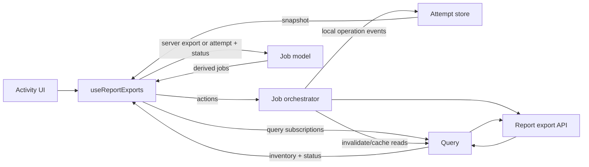

# Report Export Architecture

The report-export flow has three core parts:

- `report-export-job-model.ts` defines the attempt and job types. It derives UI views and available actions from client operation state and server status, and selects and retains inventory entries. It does not own mutable state or make requests.
- `report-export-attempt-store.ts` holds in-memory state for local operations. Its reducer applies allowed lifecycle transitions synchronously and notifies subscribers; passive server-discovered exports are not stored as attempts.
- `report-export-job-orchestrator.ts` coordinates side effects: creating and canceling exports, starting downloads, retrying failures, and dispatching operation events to the store.

## How They Work Together

`useReportExports.ts` connects these parts to TanStack Query and the UI:

1. A user action goes through the hook to the orchestrator.
2. The orchestrator creates or updates an attempt by dispatching an event to the store.
3. TanStack Query owns server status and inventory. The hook projects discovered inventory rows directly into jobs and subscribes to the attempt store for local operations.
4. The model combines a server-discovered export or local operation attempt with its server status to derive the job view shown by the activity UI.
5. When a tracked export is ready for transfer, the orchestrator claims the transfer through a synchronous store transition, downloads the bytes, and hands them to the browser. The store records completion or failure.

## State Ownership

TanStack Query is authoritative for server inventory, generation status, progress, and server errors. Discovered jobs are projected from query results rather than mirrored in the attempt store. The attempt store owns only client-side operation state, such as an in-flight create or cancellation request, transfer/retry progress, handoff, and errors the server cannot observe. Job views are derived from query data and any matching local operation state.

Direct downloads use a separate path. They do not need asynchronous export-status polling or inventory recovery.
