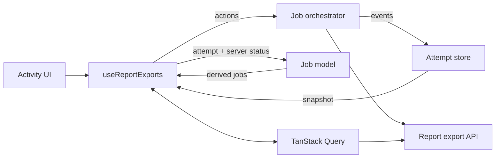

# Report Export Architecture

The report-export flow has three core parts:

- `report-export-job-model.ts` defines the attempt and job types. It derives UI views and available actions from client attempt state and server status, and selects and retains inventory entries. It does not own mutable state or make requests.
- `report-export-attempt-store.ts` holds the in-memory attempt snapshot. Its reducer applies allowed lifecycle transitions synchronously and notifies subscribers.
- `report-export-job-orchestrator.ts` coordinates side effects: creating and canceling exports, starting downloads, retrying failures, merging server inventory, and dispatching events to the store.

## How They Work Together

`useReportExports.ts` connects these parts to TanStack Query and the UI:

1. A user action goes through the hook to the orchestrator.
2. The orchestrator creates or updates an attempt by dispatching an event to the store.
3. TanStack Query owns server status and inventory. The hook subscribes to the attempt store and queries status for tracked exports.
4. The model combines an attempt with its server status to derive the job view shown by the activity UI.
5. When a tracked export is ready for transfer, the orchestrator claims the transfer through a synchronous store transition, downloads the bytes, and hands them to the browser. The store records completion or failure.

## State Ownership

TanStack Query owns server state, including generation status and inventory. The attempt store owns client-side lifecycle state, such as creation, transfer, handoff, and transfer errors. Job views are derived from those two sources rather than stored separately.

Direct downloads use a separate path. They do not need asynchronous export-status polling or inventory recovery.
